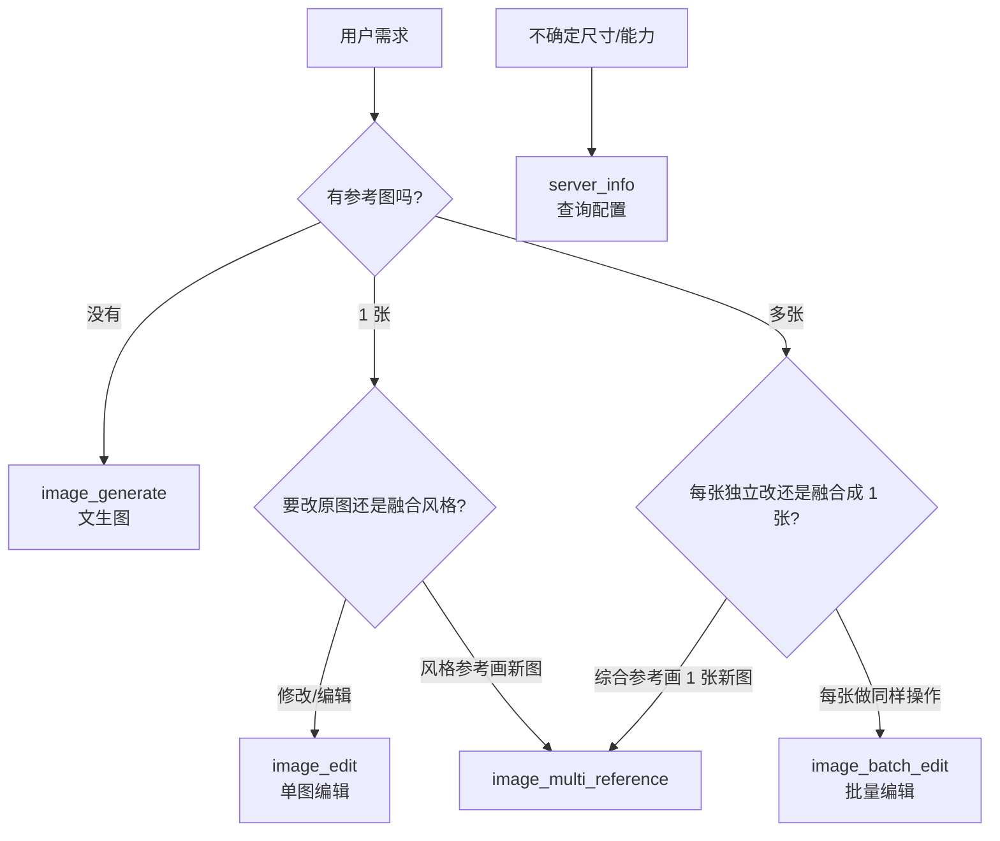

# twgga-image-mcp 使用教程

面向 Cursor / Claude Code / Codex 等 MCP 客户端用户，帮助你快速理解并正确使用「TWGGA 画图 MCP」的全部能力。

---

## 一、这是什么？

**twgga-image-mcp** 是一个 MCP（Model Context Protocol）服务器，把 [TWGGA API](https://twgga.work) 的图像生成能力封装成 5 个工具，让 AI 助手可以直接：

- 根据文字描述生成图片
- 编辑已有图片（换背景、改局部、加细节等）
- 批量处理多张图片
- 融合多张参考图生成新图
- 查询当前配置与能力边界

生成的图片会**自动保存到本地磁盘**，返回结果中包含文件的绝对路径，方便你在 IDE 或文件管理器中打开。

当前仅支持 `gpt-image-2`。从 v0.5.0 起支持**连续编辑**：同一张图可以接着改，MCP 记住每一版图片和已经提过的要求，见 [4.6](#46-连续编辑session_id)。

> **先说清一件事**：`size` 不决定输出像素。本站实测输出约 157 万像素，与请求的尺寸无关：请求 3840x2160、2048x1152、1536x1024 都返回 1254×1254。想要横图或竖图，把画幅写进 prompt，例如「16:9 宽幅横构图」得到 1672×941、「9:16 竖幅海报」得到 941×1672。返回结果里的 `size_honored` 与 `saved.actual_size` 是准的，请以它们为准，不要向用户承诺 2K/4K。

---

## 二、安装与配置

### 2.1 一行命令安装（推荐）

Windows PowerShell：

```powershell
irm https://raw.githubusercontent.com/Rousseal1984/twgga-image-mcp/main/scripts/install.ps1 | iex
```

macOS / Linux：

```bash
curl -fsSL https://raw.githubusercontent.com/Rousseal1984/twgga-image-mcp/main/scripts/install.sh | sh
```

脚本会下载最新版程序、核对 `SHA256SUMS`，再运行程序自带的 `install --yes`：把程序复制到固定位置，写入 Claude Code（`~/.claude.json`）和 Codex（`~/.codex/config.toml`）的 `twgga-image` 配置。不需要 Python。

首次安装时如果还没保存过 Key，终端会提示输入一次，输入内容不显示。Key 需以 `sk-` 开头，并且能调用 `gpt-image-2`。

### 2.2 API Key 保存在哪

Key **不会**写进任何客户端配置文件，而是存进系统自带的安全凭据库，MCP 每次启动时自己读取：

| 平台 | 保存位置 |
|------|----------|
| Windows | 凭据管理器 → Windows 凭据，条目名 `image2-api-key.twgga-image-mcp` |
| macOS | 钥匙串，service=`twgga-image-mcp`、account=`image2-api-key` |
| Linux | Secret Service |

- 环境变量 `TWGGA_API_KEY` 非空时优先用它；旧版配置里的明文 Key 会在安装时迁移进凭据库并从配置里删除。
- 更换 Key：运行安装位置下的 `twgga-image-mcp credentials set`（隐藏输入，不改客户端配置）。
- macOS 后台启动不会弹钥匙串窗口；若提示未授权，在终端运行 `twgga-image-mcp credentials authorize`。

### 2.3 手动配置 Cursor

在 `~/.cursor/mcp.json` 中添加，`command` 指向安装位置下的程序（Windows 为 `%LOCALAPPDATA%\twgga-image-mcp\bin\twgga-image-mcp.exe`），`env` 里不要放 Key：

```json
{
  "mcpServers": {
    "twgga-image-mcp": {
      "command": "C:\\Users\\你的用户名\\AppData\\Local\\twgga-image-mcp\\bin\\twgga-image-mcp.exe",
      "args": [],
      "env": {
        "TWGGA_SAVE_DIR": "C:\\Users\\你的用户名\\Pictures\\twgga-out",
        "TWGGA_SAVE_DIR_ROOT": "C:\\Users\\你的用户名\\Pictures\\twgga-out"
      }
    }
  }
}
```

配置完成后**重启 Cursor**，在 MCP 面板中确认 `twgga-image-mcp` 显示为已连接。

### 2.4 Claude Desktop 普通对话模式

Claude Desktop 的 Code 模式读的是 `~/.claude.json`，安装器已经写好。普通对话（Chat）模式使用独立文件，安装器**不会**自动写入：

- Windows：`%APPDATA%\Claude\claude_desktop_config.json`
- macOS：`~/Library/Application Support/Claude/claude_desktop_config.json`

把 `~/.claude.json` 里的 `mcpServers.twgga-image` 整节复制进去，保留文件里其他 server，然后重启 Desktop。Key 已在系统凭据库里，不要复制明文 Key。

### 2.5 环境变量说明

| 变量 | 默认值 | 说明 |
|------|--------|------|
| `TWGGA_API_KEY` | 空 | 设置后优先于系统凭据库；一般不需要设置 |
| `TWGGA_BASEURL` | `https://twgga.work` | TWGGA API 地址 |
| `TWGGA_MODEL` | `gpt-image-2` | 默认模型 |
| `TWGGA_SAVE_DIR` | `~/Pictures/twgga-out` | 默认输出目录 |
| `TWGGA_SAVE_DIR_ROOT` | 同 `TWGGA_SAVE_DIR` | 安全根目录，所有输出与会话记录都在其下 |
| `TWGGA_USE_SHELL_PROXY` | `0` | 设为 `1` 才读取系统 shell 代理 |

### 2.6 升级

已安装的 MCP 不会自动更新。**重新运行 2.1 的一行命令即可升级**，已保存的 Key 不用重新输入。完成后重新连接 MCP，调用 `server_info` 确认 `version` 已是新版本。只替换下载的文件不会生效，客户端启动的是安装位置下的那份程序。

---

## 三、连通性验证

### 3.1 当前线路实测结果（2026-08-14）

| 检查项 | 状态 | 说明 |
|--------|------|------|
| `/v1/models` | ✅ 正常 | 当前 Key 可见 `gpt-image-2` |
| MCP 握手 | ✅ 正常 | `initialize` + `tools/list` 返回 5 个工具 |
| `image_generate` | ✅ 已验证 | 出图正常；实际像素见 `saved.actual_size` |
| `image_edit` | ✅ 已验证 | 单图参考 1024²、2048×1152、3840×2160 可用 |
| 2026-11-09 复测 | ✅ 正常 | 文生图 1280x720/high 实得 1225×1284；两张 JPEG 参考图融合实得 1536×1024 |

### 3.2 如何自行验证

在 Cursor 对话中让 AI 执行：

```
请调用 twgga-image-mcp 的 server_info，告诉我当前配置和能力矩阵。
```

预期返回 `api_key_configured: true` 及完整的 `capability_matrix`。

再测试生图：

```
请用 image_generate 生成一张 1024x1024 的红苹果简笔画，basename 设为 test_apple。
```

成功时返回示例：

```json
{
  "ok": true,
  "model": "gpt-image-2",
  "size": "1024x1024",
  "saved": [
    {
      "path": "/home/wcx/Pictures/twgga-out/test_apple.png",
      "size_bytes": 123456,
      "actual_size": "1254x1254",
      "actual_megapixels": 1.57,
      "format": "png"
    }
  ],
  "size_honored": false,
  "errors": [],
  "notes": ["⚠ 实际 1254×1254 (1.57MP) ≠ 请求 1024×1024 (1.05MP)；本站生图不保证精确像素……"]
}
```

### 3.3 常见线路问题与解决

高负载或特殊代理环境中可能遇到两类错误：

**① HTTP 524 超时**

```
HTTP 524: A timeout occurred
```

原因：高负载时响应超过 Cloudflare 120 秒限制。  
处理：MCP 已内置自动重试；仍失败时改小尺寸（如 `1024x1024`）或稍后重试。

**② SSRF 防护拦截图片下载（旧版本 / 已关闭 fake-ip 放行时）**

```
保存失败: 下载 URL host 'oss.filenest.top' 指向受限地址 198.18.1.23（私网/环回/链路本地/保留），已拒绝（SSRF 防护）
```

原因：Images API 的 URL 响应需二次下载。若系统 DNS 将 `oss.filenest.top` 解析到 `198.18.1.x`（Clash / Surge **fake-ip**），且 `TWGGA_ALLOW_FAKE_IP_DOWNLOAD=0` 时会被拒绝。

**当前版本默认已双层修复，通常无需改代理：**

1. **主路径** `TWGGA_RESPONSE_FORMAT=auto`（默认）：先请求 `url` 并下载落盘，失败再重试 `b64_json`
2. **URL 路径** `TWGGA_ALLOW_FAKE_IP_DOWNLOAD=1`（默认）：可信 CDN（`oss.filenest.top`）解析到 fake-ip 时仍允许下载，**不影响 VPN 正常功能**

若仍失败，可检查 `server_info` 中 `response_format` / `allow_fake_ip_download` 是否为预期值；或临时在代理中将 `oss.filenest.top` 加入 fake-ip 排除列表。

---

## 四、五个工具详解

### 工具选择速查



---

### 4.1 `server_info` — 配置与能力查询

**用途**：在调用任何生图工具之前，先了解当前运行时配置、尺寸规则、各工具能力边界。

**参数**：无

**返回要点**：

- `api_key_configured`：Image2 密钥是否配置
- `credentials.status`：Key 来自哪里（`system_store` 系统凭据库 / `environment` 环境变量 / `missing` 未配置）
- `recommended_sizes`：各档位推荐尺寸
- `capability_matrix`：各工具 × 各尺寸档的可用性
- `retry_policy`：重试与并发策略
- `safety_constraints`：安全限制（输出目录、输入大小等）

**使用场景**：

- 首次使用前确认配置是否正确
- 不确定该用哪个尺寸时查阅 `recommended_sizes`
- 确认 `saved.actual_size` 与你请求的尺寸差多少（本站不保证精确像素）

**示例对话**：

> 请先调用 server_info，告诉我 2K 文生图是否可用，以及推荐尺寸。

---

### 4.2 `image_generate` — 文生图

**用途**：根据文字描述从零生成 1～10 张图片。

**何时使用**：

- 用户说「画一张…」「生成一张…」「创建 logo/海报/壁纸」
- **没有**提供任何参考图

**参数**：

| 参数 | 类型 | 必填 | 说明 |
|------|------|------|------|
| `prompt` | string | ✅ | 图像描述，1–2000 字符 |
| `size` | string \| null | | `"WxH"` 格式，如 `"1024x1024"`；留空则从 prompt 关键字自动推断 |
| `n` | int | | 生成张数 1–10；1K 可多张并发，≥2K 强制 n=1 |
| `model` | string \| null | | 只接受 `gpt-image-2`；留空即用它 |
| `quality` | string \| null | | `auto` / `low` / `medium` / `high`；留空使用后端默认值 |
| `output_format` | string \| null | | `png` / `jpeg` / `webp`；留空不发送，实际格式见 `saved[].format` |
| `session_id` | string \| null | | 传 `"new"` 开启连续编辑会话（要求 `n=1`），见 4.6 |
| `context` | object \| null | | 会话里要长期保持的约束，如 `{"identity": "同一只橘猫"}` |
| `save_dir` | string \| null | | 输出目录，必须在 `TWGGA_SAVE_DIR_ROOT` 下 |
| `basename` | string \| null | | 文件名前缀，仅允许 `[A-Za-z0-9_\-.]` |
| `api_key` | string \| null | | 临时覆盖系统凭据库中的 Key |

**尺寸速查**：

| 档位 | 推荐尺寸 | 实际输出 | 速度 |
|------|----------|----------|------|
| 1K | `1024x1024`, `1536x1024`, `1024x1536` | 可用 | 实际像素见 `saved.actual_size` |
| 2K | `2048x2048`, `2048x1152`, `1152x2048` | 可用 | 强制 `n=1` 并串行 |
| 4K | `3840x2160`, `2160x3840` | 可用 | 强制 `n=1` 并串行 |

> W 和 H 必须是 **16 的倍数**；最长边 ≤3840，长宽比 ≤3:1，总像素为 655,360–8,294,400。`1920x1080` 不对齐，请改用 `1920x1088` 或推荐的 `2048x1152`。

**Prompt 写法建议**：

- 中英文均可；gpt-image-2 文字渲染能力强，可直接在 prompt 中写要显示的文字
- 越具体越好：风格、视角、光线、主体、细节程度
- 例：`"极简风格寿司吉祥物 logo，柔和粉彩配色，白色背景，居中构图"`

**示例对话**：

> 帮我生成一张赛博朋克东京夜景横屏壁纸。

AI 应把画幅写进 prompt，并如实告诉用户输出约 157 万像素：

```
image_generate(
  prompt="cyberpunk Tokyo at night, neon lights, rain reflections, cinematic, 16:9 wide landscape composition",
  size="1536x1024",
  session_id="new"
)
```

> 画 4 张可爱猫咪贴纸让我挑选。

```
image_generate(
  prompt="cute cat sticker, kawaii style, transparent-friendly composition",
  size="1024x1024",
  n=4
)
```

---

### 4.3 `image_edit` — 单图编辑

**用途**：接受 1 张本地图片 + 修改指令，输出编辑后的图片。

**何时使用**：

- 用户提供 **1 张图**，要修改、替换、添加或删除某部分
- 对刚生成的图做后续调整

**参数**：

| 参数 | 类型 | 必填 | 说明 |
|------|------|------|------|
| `prompt` | string | ✅ | 修改指令 |
| `image_path` | string | 见说明 | 输入图路径（绝对或相对），支持 PNG/JPG/WebP；单次编辑或新会话必填，已有会话可省略 |
| `mask_path` | string \| null | | 可选 alpha mask PNG；透明区域 = 编辑区，不透明 = 保留；只作用于本轮 |
| `size` | string | | 输出尺寸，默认 `1024x1024`；已有会话省略时继承 |
| `model` | string \| null | | 只接受 `gpt-image-2` |
| `quality` | string \| null | | `auto` / `low` / `medium` / `high`；已有会话省略时继承 |
| `output_format` | string \| null | | `png` / `jpeg` / `webp` |
| `session_id` | string \| null | | `"new"` 开新会话；传返回的 `session.id` 接着改，见 4.6 |
| `parent_revision` | int \| null | | 从会话里的旧版本另开分支；省略用最新版本 |
| `context` | object \| null | | 长期约束，字符串覆盖同名键，`null` 移除 |
| `save_dir` | string \| null | | 输出目录 |
| `basename` | string \| null | | 文件名前缀 |
| `api_key` | string \| null | | 临时覆盖 Key |

**Mask 工作原理**：

- `mask_path` 指向与输入图同尺寸的 PNG
- **alpha=0（透明）** 的像素 → 要修改的区域
- **alpha=255（不透明）** 的像素 → 保持原样
- 不传 mask → 模型自由决定修改范围

**尺寸限制**：

| 档位 | 可用性 | 说明 |
|------|--------|------|
| 1K | ✅ 已验证 | 1024×1024 edits 成功；实际像素见 `saved.actual_size` |
| 2K | ✅ 已验证 | 2048×1152 edits 成功；实际像素见 `saved.actual_size` |
| 4K | ✅ 已验证 | 3840×2160 edits 成功；实际像素见 `saved.actual_size` |

**示例对话**：

> 把 `/home/wcx/Pictures/portrait.jpg` 的背景换成日落海滩，人物保持不变。

```
image_edit(
  prompt="replace background with a sunset beach, keep the subject pixel-identical",
  image_path="/home/wcx/Pictures/portrait.jpg"
)
```

> 只把头发改成银色（我有 mask 文件）。

```
image_edit(
  prompt="change hair color to silver",
  image_path="/home/wcx/Pictures/x.png",
  mask_path="/home/wcx/Pictures/x_mask.png"
)
```

---

### 4.4 `image_batch_edit` — 批量编辑

**用途**：对多张输入图分别应用**同一条**修改指令，N 张进 → N 张出。

**何时使用**：

- 多张图要做相同操作：批量换底、统一调色、加水印、转素描风格等

**何时不用**：

- 只有 1 张图 → 用 `image_edit`
- 多张图作风格参考画 1 张新图 → 用 `image_multi_reference`

**参数**：

| 参数 | 类型 | 必填 | 说明 |
|------|------|------|------|
| `prompt` | string | ✅ | 应用到每张图的指令 |
| `image_paths` | string[] | ✅ | 输入图路径列表，建议 2–20 张 |
| `size` | string | | 支持 1K/2K/4K，≥2K 强制串行；默认 `1024x1024` |
| `model` | string \| null | | 模型 |
| `save_dir` | string \| null | | 输出目录；文件名为 `batch_<时间戳>_<序号>.png` |
| `api_key` | string \| null | | 临时覆盖 Key |

**并发策略**：

- `gpt-image-2`：5 并发
- ≥2K 批次：串行 + 1.5s 间隔，避免把并发打满
- 单张失败不影响其他张

**示例对话**：

> 把这 3 张产品图都转成铅笔素描风格。

```
image_batch_edit(
  prompt="convert to pencil sketch style",
  image_paths=[
    "/home/wcx/Pictures/product_a.jpg",
    "/home/wcx/Pictures/product_b.jpg",
    "/home/wcx/Pictures/product_c.jpg"
  ],
  size="1024x1024"
)
```

---

### 4.5 `image_multi_reference` — 多图融合参考

**用途**：输入 2–10 张参考图 + prompt，综合所有图的视觉信息，输出 **1 张全新**的图片。

**何时使用**：

- 「这几张是同一产品不同角度，画一个新角度」
- 「按这些图的风格画一张 X」
- 「这是 logo 主图和辅助图，做成海报」

**与 `image_batch_edit` 的区别**：

| | `image_batch_edit` | `image_multi_reference` |
|--|-------------------|------------------------|
| 输入 | N 张图 | 2–10 张图 |
| 输出 | N 张图（每张独立改） | **1 张**新图（融合参考） |
| 场景 | 批量做同样操作 | 综合多张图的风格/元素 |

**参数**：

| 参数 | 类型 | 必填 | 说明 |
|------|------|------|------|
| `prompt` | string | ✅ | 综合指令 |
| `image_paths` | string[] | ✅ | 2–10 张参考图路径 |
| `size` | string | | 输出尺寸，默认 `1024x1024` |
| `model` | string \| null | | 模型 |
| `save_dir` | string \| null | | 输出目录 |
| `basename` | string \| null | | 文件名前缀 |
| `api_key` | string \| null | | 临时覆盖 Key |

**限制**：

- 单张参考图建议 ≤2MB，总输入 ≤8MB
- 1K/2K/4K 均可用；建议一律核对 `saved.actual_size`

**示例对话**：

> 把草图、角色、背景这三张图融合成一张电影海报。

```
image_multi_reference(
  prompt="combine these into a single cinematic poster with dramatic lighting",
  image_paths=[
    "/home/wcx/Pictures/sketch.png",
    "/home/wcx/Pictures/character.png",
    "/home/wcx/Pictures/background.png"
  ]
)
```

---

### 4.6 连续编辑：`session_id`

`image_generate` 和 `image_edit` 共用一套持久会话。会话保存每一版成功的图片、编辑要求和有效约束，重启 MCP 后也能接着改。

| 你说的话 | 工具调用 | 会话结果 |
|---|---|---|
| 生成一只小猫跳伞 | `image_generate(session_id="new")` | A，第 1 版 |
| 把降落伞换成滑翔伞 | `image_edit(session_id=A)` | A，第 2 版 |
| 再生成一张海景人像 | `image_generate(session_id="new")` | B，第 1 版 |
| 回到小猫，背景改成日落 | `image_edit(session_id=A)` | A，第 3 版 |

要点：

- 第一次传 `"new"`，之后传返回的 `session.id`；ID 由 AI 记住，用户不需要看到。
- 已有会话里省略 `image_path`、`size`、`quality`、`model` 时，自动沿用所选版本；MCP 自动上传该版本图片。
- `context` 写要长期保持的东西，例如人物面容、服装、背景。本轮 prompt 优先于历史和约束；要改长期属性时同时更新对应的键。
- 失败的调用不推进版本；同一会话正在处理时再调用会返回「该编辑会话正在处理另一轮请求，请稍后重试」。
- 外部图片想开始连续编辑：`image_edit(image_path=..., session_id="new")`。`image_multi_reference` 不维护会话，要细化它的结果也用这个办法。

示例：

```
image_generate(
  prompt="画一个穿红衣服的女孩，日落海边，自然的摄影构图",
  session_id="new",
  context={"identity": "同一女孩的面容和发型", "clothing": "红色衣服", "background": "日落海边"}
)

image_edit(
  prompt="衣服改成蓝色，保留背景和人物面容",
  session_id="edit_<返回的32位标识>",
  context={"clothing": "蓝色衣服"}
)
```

更多细节见 [连续编辑指南](multi-turn-editing.md)。

---

## 五、尺寸与能力矩阵

### 5.1 核心规则

1. **W/H 必须是 16 的倍数**（Image2 路径）
2. **最长边 ≤3840，长宽比 ≤3:1**
3. **总像素 655,360–8,294,400**
4. **≥2K 强制串行**，且 **n 强制为 1**
5. **2K/4K 有跨进程锁**：多窗口同时请求会串行排队

### 5.2 各场景能力

| 场景 | 工具 | 可靠性 | 实际输出 |
|------|------|--------|----------|
| 1K 文生图 | `image_generate` | ✅ 已验证 | 实际像素以 `saved.actual_size` 为准 |
| 2K/4K 文生图 | `image_generate` | ✅ 已验证 | 实际像素以 `saved.actual_size` 为准 |
| 1K 单图编辑 | `image_edit` | ✅ 已验证 | 实际像素以 `saved.actual_size` 为准 |
| 2K/4K 带参考图编辑 | `image_edit` | ✅ 已验证 | 实际像素以 `saved.actual_size` 为准 |
| 1K 多图融合 | `image_multi_reference` | ✅ 历史验证 | 核对 `saved.actual_size` |
| 2K/4K 多图融合 | `image_multi_reference` | ✅ 已开放 | ≥2K 串行；失败时直接返回 Images API 错误 |
| 批量编辑 ≥2K | `image_batch_edit` | ✅ 已开放 | 逐张串行 + 1.5s 间隔 |

### 5.3 想要大图怎么办

本站输出约 157 万像素，与请求的 `size` 无关。请求 2K/4K 只会强制 `n=1` 并串行排队，**不会更清晰**。正确做法：

- 把画幅写进 prompt，例如「16:9 宽幅横构图」「9:16 竖幅海报」。
- 如实告诉用户实际像素（`saved.actual_size`），需要更大尺寸时在本地放大。

---

## 六、会话记录与清理

会话记录是 MCP 保存在你电脑上的 JSON 文件，位于 `TWGGA_SAVE_DIR_ROOT/.twgga-sessions/edit_<id>/`，每个成功版本一个文件，不含图片本身；图片仍在正常输出目录。

- 只想清除记忆：把对应的 `edit_<id>` 目录移走，图片仍保留。
- 不要在请求进行中删除会话目录或锁文件。
- 目前没有自动清理，占用估算与归档方法见 [会话存储说明](session-storage.md)。

---

## 七、返回结果字段说明

所有生图工具返回 JSON 字典，通用字段：

| 字段 | 类型 | 说明 |
|------|------|------|
| `ok` | bool | 是否至少成功 1 张/次 |
| `model` | string | 实际使用的模型 |
| `size` | string | 请求的尺寸 |
| `saved` | list/dict | 成功保存的文件信息 |
| `errors` | list | 失败描述列表 |
| `notes` | list | 路由决策、降级、尺寸偏差等说明 |

`saved` 中每项包含：

| 字段 | 说明 |
|------|------|
| `path` | 文件绝对路径 |
| `size_bytes` | 文件字节数 |
| `actual_size` | 从图片 header 读出的真实像素（如 `"1254x1254"`） |
| `actual_megapixels` | 实际百万像素 |
| `format` | 按文件内容判定的格式（`png` / `jpeg` / `webp`） |

使用会话时，结果里另有 `session`：`id`、`revision`（当前版本号）、`parent_revision`（编辑来源）和 `context`（当前有效约束）。

> **注意**：`size` 只是建议，任何尺寸都可能被重映射；**始终**以 `saved.actual_size` 为准。需要精确构图时把画幅要求写进 prompt。

---

## 八、安全机制

MCP 内置多项安全限制：

| 限制 | 说明 |
|------|------|
| 输出目录牢笼 | 所有输出必须在 `TWGGA_SAVE_DIR_ROOT` 下 |
| basename 校验 | 仅允许 `[A-Za-z0-9_\-.]`，禁止 `/`、`..` |
| 输入图校验 | 按 magic bytes 识别并完整解码；仅允许 PNG/JPEG/WebP，截断或损坏文件在请求前拒绝 |
| 输入大小 | 单图 ≤4MB；多图参考总和 ≤8MB |
| 响应大小 | 远端响应 ≤25MB |
| SSRF 防护 | 拒绝真内网地址；可信 CDN + fake-ip（198.18.0.0/15）在默认配置下放行 |
| base_url 锁定 | 运行期不可通过 tool 参数修改 API 地址 |
| Key 存储 | 存在系统凭据库，不写入任何客户端配置文件，也不出现在返回结果里 |

---

## 九、常见错误与排查

| 错误信息 | 原因 | 解决方案 |
|----------|------|----------|
| `未配置 API key` / 提示运行 `credentials` | 系统凭据库和环境变量里都没有 Key | 重新运行 2.1 的一行命令，或运行 `twgga-image-mcp credentials set` |
| `……下模型 gpt-image-2 无可用渠道` | Key 所在分组不含生图 | 在控制台把 Key 的分组改为包含 gpt-image-2 的分组 |
| `不支持 model=…` | 传了本站没有的模型名 | 去掉 `model` 参数或改为 `gpt-image-2` |
| `output_format 不支持 'gif'` | 本站不提供动图 | 改用 `png` / `jpeg` / `webp` |
| `该编辑会话正在处理另一轮请求` | 同一会话的上一次调用还没结束 | 等它完成后再试 |
| `size W/H 必须是 16 的倍数` | 尺寸不符合约束 | 改为如 `1024x1024`、`2048x1152` |
| `HTTP 524: timeout` | 请求超时 | 改小尺寸或稍后重试；2K/4K 高负载时偶发 |
| `SSRF 防护` + `198.18.x.x` | 旧版或 `TWGGA_ALLOW_FAKE_IP_DOWNLOAD=0` | 升级 MCP 或设 `TWGGA_ALLOW_FAKE_IP_DOWNLOAD=1`；`auto` 模式下 URL 失败会自动重试 `b64_json` |
| `image_path 不存在` | 路径错误 | 使用绝对路径 |
| `basename 含非法字符` | 文件名不规范 | 仅用字母数字下划线连字符 |
| `save_dir 必须在 TWGGA_SAVE_DIR_ROOT 之下` | 输出目录越界 | 使用配置的默认目录或其子目录 |

---

## 十、实用对话模板

### 文生图

```
请用 twgga-image-mcp 生成一张 [描述]，尺寸 [WxH]，保存为 [basename]。
```

### 编辑已有图

```
请编辑图片 [绝对路径]，[修改要求]。
```

### 批量处理

```
请对以下图片批量 [操作]：
- /path/to/a.jpg
- /path/to/b.jpg
- /path/to/c.jpg
```

### 多图融合

```
请参考以下图片的风格/元素，生成一张 [新图描述]：
- /path/to/ref1.png
- /path/to/ref2.png
```

### 连续编辑

```
刚才那张图，把背景改成雪山，人物保持不变。
```

AI 会沿用那张图的会话 ID 调用 `image_edit`，不需要你提供路径。

### 查询能力

```
请先调用 server_info，告诉我当前支持哪些尺寸和模型。
```

---

## 十一、输出文件位置

默认保存目录：`~/Pictures/twgga-out`（可通过 `TWGGA_SAVE_DIR` 修改）

文件命名规则：

| 工具 | 默认前缀 |
|------|----------|
| `image_generate` | `gen_<时间戳>` 或 `gen_<时间戳>_<序号>` |
| `image_edit` | `edit_<时间戳>` |
| `image_batch_edit` | `batch_<时间戳>_<序号>` |
| `image_multi_reference` | `multiref_<时间戳>` |

生成成功后，AI 会返回 `saved[].path`，你可以直接在文件管理器或 IDE 中打开。

---

## 十二、卸载

```bash
# 仅移除 MCP 配置（Claude Code + Codex），在安装位置运行
twgga-image-mcp reset --yes
```

`reset` 不会删除已保存的 Key。如需一并删除：

- Windows：凭据管理器里删除 `image2-api-key.twgga-image-mcp`，或运行 `cmdkey /delete:image2-api-key.twgga-image-mcp`
- macOS：`security delete-generic-password -s twgga-image-mcp -a image2-api-key`

最后删除安装目录（Windows 为 `%LOCALAPPDATA%\twgga-image-mcp`）。Cursor 和 Claude Desktop 普通对话模式需手动删除对应配置节。

---

## 附录：工具 API 速查表

| 工具 | 必填参数 | 主要用途 |
|------|----------|----------|
| `server_info` | 无 | 查询配置与能力 |
| `image_generate` | `prompt` | 文生图 |
| `image_edit` | `prompt`, `image_path` | 单图编辑 |
| `image_batch_edit` | `prompt`, `image_paths` | 批量同指令编辑 |
| `image_multi_reference` | `prompt`, `image_paths`（2–10 张） | 多图融合成 1 张 |

---

*文档版本：适用于 twgga-image-mcp v0.5.0。*
